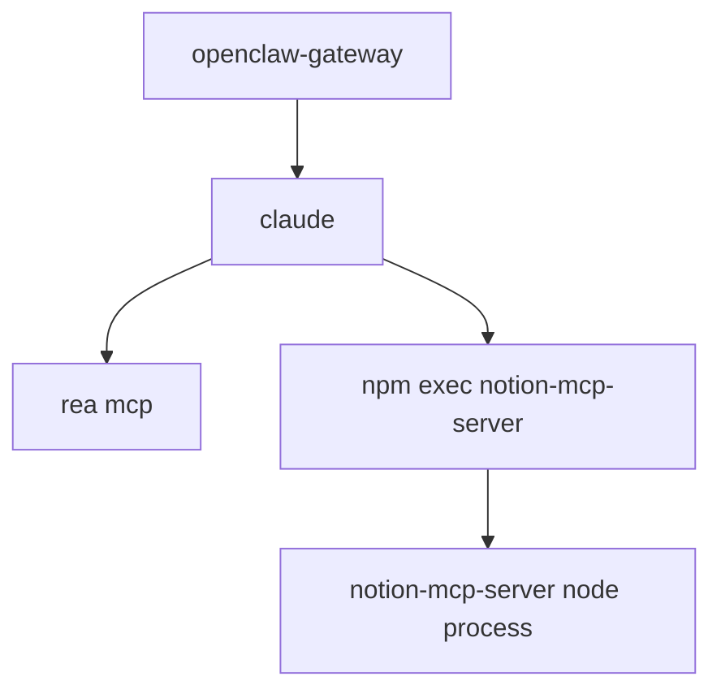

# Concepts

## Run stack

When an OpenClaw agent run uses the `claude` CLI, the gateway starts a private process tree for it:

clawtop calls that tree a **run stack** and sizes it as one unit. The PID shown in the table is the
`claude` process, the stack leader. Killing a stack kills the whole tree.

Each stack is roughly 0.5 to 0.7 GB, mostly the `claude` process and the `rea` MCP server.

## Columns

| Column | Meaning |
|---|---|
| `PID` | The leader (`claude`) process |
| `AGENT` | Taken from the run's workspace directory name |
| `SESSION` | First 8 characters of the **claude CLI** session id |
| `IDLE` | Time since the run last wrote to its transcript |
| `AGE` | Time since the process started |
| `CTX` | Size of the run's transcript file; a rough measure of its context |
| `MEM` | The whole stack, as PSS (below) |
| `PARTS` | The MCP helpers in the stack |
| flag | `STALE` (idle past the threshold, 30 minutes by default) or `ORPHAN` |

### Why `IDLE` and not just age

A run can live for hours and still be busy, or be stuck since minutes after it started. `IDLE` reads the
modification time of the claude transcript at
`~/.claude/projects/<workspace path with / and . replaced by ->/<session-uuid>.jsonl`. When that file is
missing, `IDLE` falls back to `AGE`.

### PSS

Memory is measured as **PSS** (proportional set size): pages shared between processes are divided among
them. Stacks therefore add up to the cgroup total instead of double-counting shared libraries.

## What counts as a gateway run

clawtop only ever lists or kills processes that look gateway-spawned:

- its working directory is under `/opt/openclaw/workspaces/`, or
- its command line contains `/tmp/openclaw-cli-mcp-` (the gateway's temporary MCP config), or
- its command line contains `--plugin-dir /tmp/openclaw/`.

A `claude` or `npm exec` you started yourself matches none of these and is never touched.

An **orphan** is a gateway-signed stack whose parent process is gone (for example after a crash). Orphans
keep holding memory until killed.

## Cgroup numbers

The gateway's cgroup (`memory.current`) counts everything inside it, including **page cache**. That is
why the gateway bar can look higher than main + stacks + other. The notes line shows the reclaimable
cache separately.

## Sessions are not run stacks

A run stack is an operating-system process. A session is OpenClaw's record of a conversation. There is
no reliable link from one to the other: the `claude` process does not carry the OpenClaw session key, and
the CLI session id is not the OpenClaw session id. clawtop therefore does not guess. It shows
the agent and CLI session id for stacks, and shows sessions separately in
[`sessions`](guides/manage-sessions.md).

## How sessions are read

`clawtop sessions` calls `openclaw sessions --all-agents --limit all --json` and uses these fields: `key`,
`status`, `ageMs`, `totalTokens`, `label` (the title), and `parentSessionKey` or `spawnedBy` (the parent).
Archived state comes from each agent's database, read-only; see
[Manage sessions](guides/manage-sessions.md#archive).
