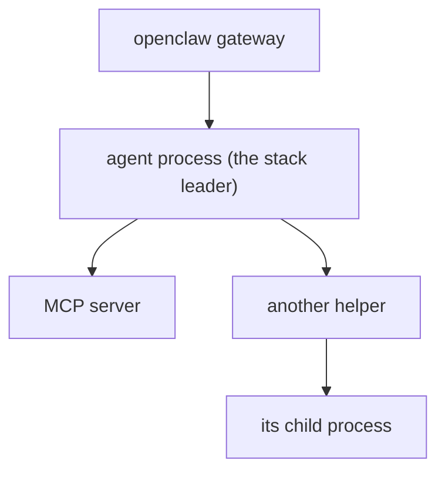

# Concepts

## Which runtimes does clawtop cover?

OpenClaw separates *model providers* from *agent runtimes*: the runtime is the loop that executes a
turn ([OpenClaw docs](https://docs.openclaw.ai/concepts/agent-runtimes)). They differ in where the work
happens, and that decides what clawtop can see:

| Runtime family | Examples | Where it runs | What clawtop shows |
|---|---|---|---|
| CLI backends | `claude-cli`, Gemini CLI | A separate process per run | A **run stack**: listed, sized, killable |
| ACP harnesses | Claude Code, Gemini CLI, OpenCode, Cursor, the Codex adapter | A separate process per run, started through ACP/acpx | A **run stack**, same as above |
| Embedded harnesses | `openclaw`, `codex`, `copilot`, `muse` | Inside the gateway process | Nothing per run: their memory is part of the gateway's **main** |

clawtop does not look for a particular program name. A **run stack** is recognised by structure (below),
so any runtime that starts an external process for an agent run is picked up and labelled by its
executable (`claude`, `gemini`, `opencode`, ...).

!!! note "What has been verified"
    The detection is tested against live `claude-cli` runs, plus synthetic process trees for other
    runtimes. Gemini CLI, ACP harnesses and the rest follow OpenClaw's documented design, but have not
    been observed on a real gateway. If a runtime of yours is missing or mislabelled, please open an issue
    with the output of `clawtop status --json` and `ps -eo pid,ppid,cmd` for that run.

## Run stack

A **run stack** is one external process the gateway started to execute an agent run, together with
everything that process started (MCP servers, shells, helper tools):

The PID in the table is the leader. Killing a stack kills the whole tree. Stack sizes depend on the
runtime and its MCP servers; in the author's setup a Claude CLI run with two MCP servers is roughly
0.5 to 0.7 GB.

### What counts as a gateway run

A process is a stack leader when **all** of these hold:

1. It is in the gateway's process tree (the gateway's cgroup), or, for leftovers outside it, its
   environment carries OpenClaw's gateway markers (`OPENCLAW_GATEWAY_SERVICE_PID`). A program you start
   from your own shell has neither, so it is never listed and never touched.
2. It is not OpenClaw's own code (workers, the spawn broker).
3. Its working directory is an **agent workspace**: the `workspace` of an agent in
   `agents.entries.*.workspace`, or a directory under `agents.defaults.workspace`, read from
   `~/.openclaw/openclaw.json`.
4. None of its ancestors is also a leader, so a stack is the whole tree under its topmost process.

Processes that fail these tests are counted in the gateway's "other": for example MCP servers the
gateway itself keeps running, which belong to no single run.

An **orphan** is a leader whose parent is no longer part of the gateway, for example after a crash.
Orphans keep holding memory until killed.

## Columns

| Column | Meaning |
|---|---|
| `PID` | The leader process |
| `RUNTIME` | The leader's executable name (`claude`, `gemini`, ...). This is the program, not OpenClaw's runtime id |
| `AGENT` | The agent whose workspace the run is in |
| `IDLE` | Time since the run last wrote to its transcript, or `-` when the runtime has no such signal |
| `AGE` | Time since the process started |
| `CTX` | Size of the run's transcript file; a rough measure of its context |
| `MEM` | The whole stack, as PSS (below) |
| `PARTS` | Names of the helper processes in the stack |
| flag | `STALE` (idle past the threshold, 30 minutes by default) or `ORPHAN` |

### Why `IDLE` can be `-`

A run can live for hours and still be busy, or be stuck minutes after it started, so age alone is a poor
signal. clawtop uses a runtime's own transcript as the activity signal. **Only Claude Code is supported
today**: its transcript is
`~/.claude/projects/<workspace path with / and . replaced by ->/<session-uuid>.jsonl`, and its
modification time is the last activity.

For every other runtime idle time is **unknown** and shown as `-`. clawtop never falls back to age,
because that would flag a busy run as stale. Consequences:

- `STALE` is only ever set where idle time is known.
- `clawtop kill --idle N` skips runs with unknown idle time and tells you how many it skipped. Use
  `--older-than` (works for every runtime) or name the PID.

Adding another runtime's transcript is a small change in `find_transcript`; contributions welcome.

### PSS

Memory is measured as **PSS** (proportional set size): pages shared between processes are divided among
them. Stacks therefore add up to the cgroup total instead of double-counting shared libraries.

## Cgroup numbers

The gateway's cgroup (`memory.current`) counts everything inside it, including **page cache**. That is
why the gateway bar can look higher than main + stacks + other. The notes line shows the reclaimable
cache separately.

## Sessions are not run stacks

A run stack is an operating-system process. A session is OpenClaw's record of a conversation. There is
no reliable link from one to the other: the process does not carry the OpenClaw session key, and a CLI
runtime's own session id is not the OpenClaw session id. clawtop therefore does not guess. It shows the
agent for stacks, and shows sessions separately in [`sessions`](guides/manage-sessions.md).

## How sessions are read

`clawtop sessions` calls `openclaw sessions --all-agents --limit all --json` and uses these fields: `key`,
`status`, `ageMs`, `totalTokens`, `label` (the title), `agentRuntime.id` (the runtime), and
`parentSessionKey` or `spawnedBy` (the parent). Archived state comes from each agent's database,
read-only; see [Manage sessions](guides/manage-sessions.md#archive).
