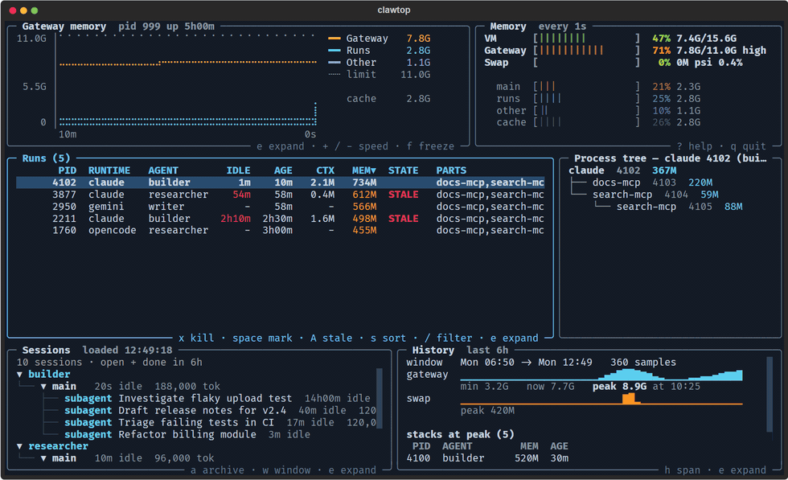
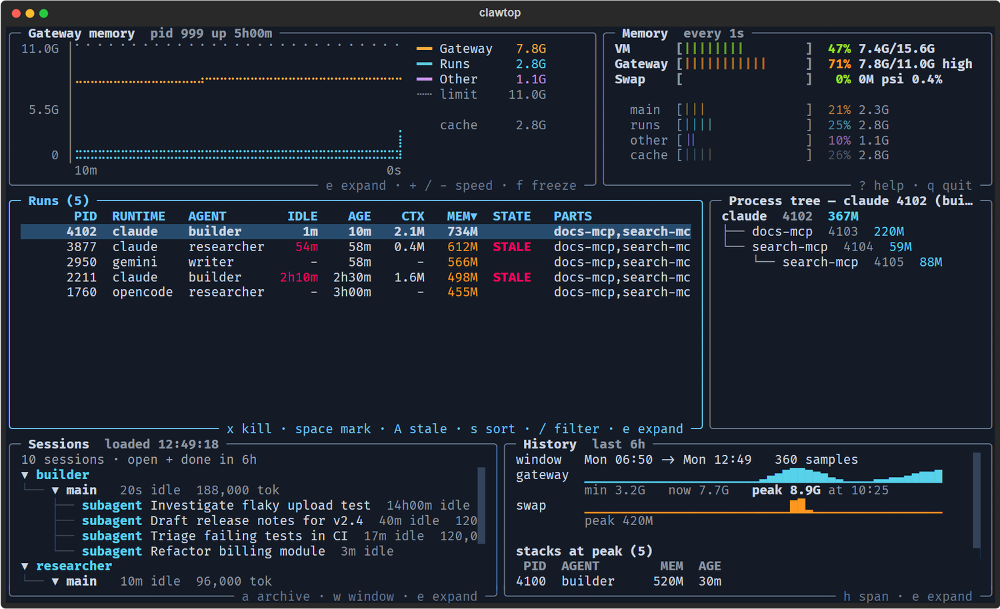
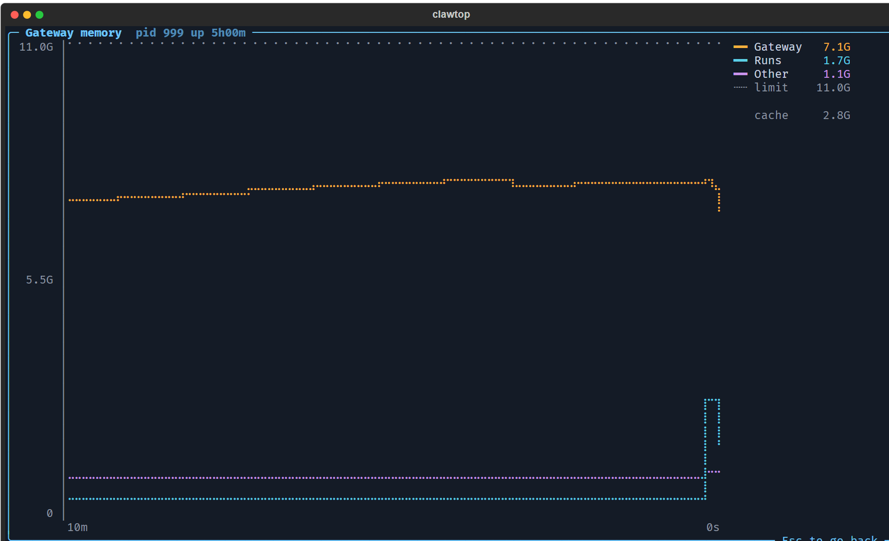
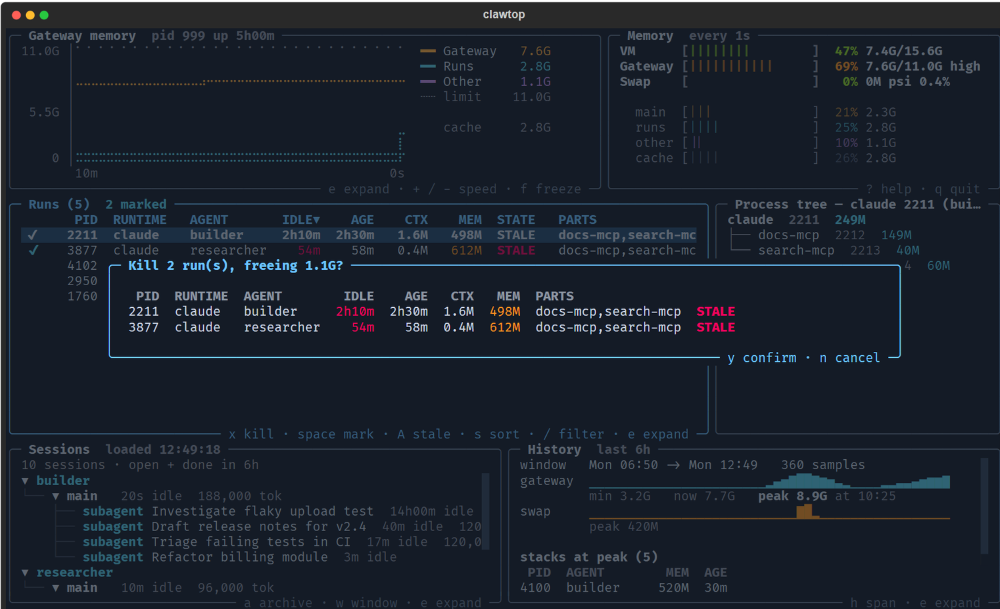
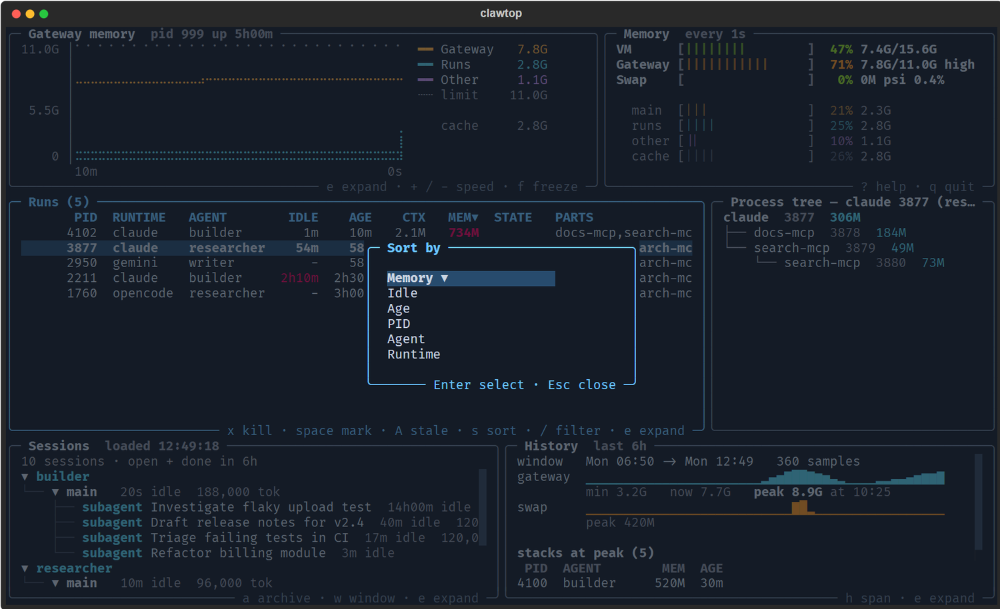
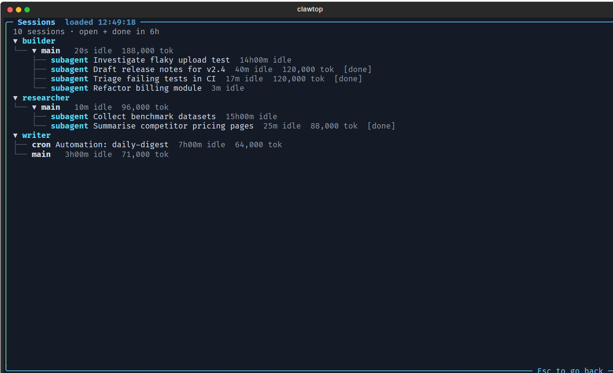

# The interactive screen

Run `clawtop` with no command and you get a live, keyboard-driven dashboard modelled on
[bottom](https://github.com/ClementTsang/bottom): the gateway's memory, every agent run, your sessions and
the memory history, all in one terminal.

```sh
clawtop                   # open the screen (refresh every 2 seconds)
clawtop top -i 5          # the same, with options: refresh every 5 seconds
```



!!! note
    The screen needs a real terminal. In a pipe, cron job or script, plain `clawtop` prints the
    one-shot status instead (the same as [`clawtop status`](watch-memory.md), which also has `--json`).
    On Windows it forwards into WSL like every other command.

## The panels

Six bordered panels share the screen. Each has its title in the top border and the keys it offers on the
bottom border. The panel that holds the focus has the bright border.



| Panel | Shows |
|---|---|
| **Gateway memory** | A braille line graph of the last 10 minutes, newest on the right, scaled from zero up to the gateway's limit (the dotted line). Three lines: the whole gateway (orange), the agent runs inside it (cyan) and OpenClaw's other children such as MCP servers (purple). It starts from the [sampler](memory-history.md) log, so it is not empty at startup. |
| **Memory** | Gauges for the VM, the gateway cgroup (against its `MemoryHigh` limit) and swap, then where the gateway's memory goes: main process, runs, other helpers and reclaimable page cache. |
| **Runs** | One row per agent run, with the same columns as `clawtop status` (see [Concepts](../concepts.md)). |
| **Process tree** | The highlighted run and every helper it started, with each process's memory. |
| **Sessions** | The same tree as [`clawtop sessions tree`](manage-sessions.md): one group per agent, subagents nested under the session that spawned them. |
| **History** | The [memory history](memory-history.md): a sparkline, the peak, and the runs that were alive at the peak. It needs the sampler; without it the panel says so. |

Sessions and history load when the screen opens and refresh every minute (sessions come from `openclaw`,
which can take a few seconds on a busy gateway).

## Moving around

| Key | Action |
|---|---|
| `Tab`, `Shift+Tab` | Next or previous panel |
| `1` `2` `3` `4` | Jump to Runs, Sessions, History, Graph |
| `e` | **Expand** the focused panel to the whole screen. `Esc` goes back |
| `↑` `↓`, `j` `k` | Move within the panel |



Keys that act on runs or sessions only work while that panel has the focus, so `x` in the Sessions panel
does nothing.

## Runs



| Key | Action |
|---|---|
| `space` | Mark or unmark the row (and move down) |
| `A` | Mark every `STALE` or `ORPHAN` run; press again to clear |
| `x`, `F9` | Kill the marked runs, or the highlighted one if none are marked. Asks first |
| `s` | Open the **sort menu**. Choose a column; choosing the current one reverses the order |
| `i` | Reverse the sort. Clicking a column header also sorts by it |
| `/` | Filter. Type words; a run must match all of them (runtime, agent, PID, helper names). `Enter` keeps the filter, `Esc` clears it |



The cursor follows the run, not the row number, so it stays on the same run when a refresh reorders the
table. Runs with unknown idle time sort last when sorting by idle.

Killing works exactly as in [Stop runaway runs](stop-runaway-runs.md): the confirmation lists every run
that will be stopped and the memory it frees, and it only ever acts on processes the gateway started.

## Sessions



| Key | Action |
|---|---|
| `Enter`, `Space` | Expand or collapse the highlighted group |
| `a` | Archive the highlighted session (asks first). Finished sessions are left alone |
| `w` | Cycle how many hours of finished sessions to show: open only, 6 h, 24 h |

## History

| Key | Action |
|---|---|
| `h` | Cycle the time span: 1 h, 6 h, 24 h, 7 d |

## Everywhere

| Key | Action |
|---|---|
| `f`, `p` | Freeze or resume refreshing (the graph title shows `FROZEN`) |
| `r` | Refresh everything now |
| `+` `-` | Refresh faster or slower (0.5 s to 30 s) |
| `?` | Show the key list |
| `q` | Quit |
| `Ctrl+P` | Textual's command palette (themes and other app-wide commands) |

## Try it without a gateway

`scripts/demo.py` runs this exact screen on made-up data, with kills and archives simulated:

```sh
uv run python scripts/demo.py
```

See [Try it without a gateway](../getting-started/try-without-a-gateway.md).

## Notes

- **Size.** The dashboard fits comfortably from about 120 columns by 34 rows. In a smaller terminal use
  `e` to look at one panel at a time.
- **Colour.** If `NO_COLOR` is set in your environment the screen is monochrome by design.
- **Refresh cost.** Each refresh reads `/proc` for your user's processes, a few milliseconds.
- **Unknown runtimes.** A run whose runtime has no activity source shows `-` for idle time and is never
  flagged `STALE`; use the age and memory columns to decide.
