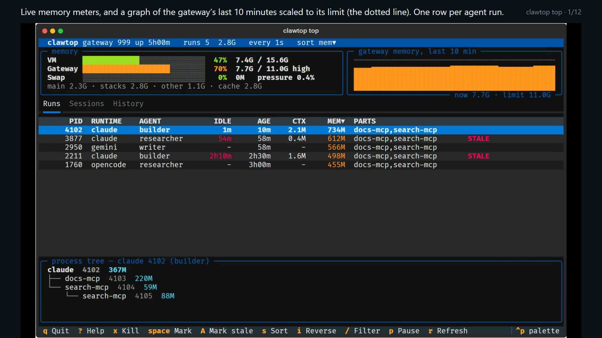

# clawtop

**htop for [OpenClaw](https://openclaw.ai).** See where your gateway's memory goes, per agent run;
stop the runaway ones safely; keep your sessions tidy.

*A walkthrough video (1:38, sample data) is on the [walkthrough page](getting-started/walkthrough.md).*

## The problem

Many OpenClaw runtimes (CLI backends such as Claude CLI or Gemini CLI, and ACP harnesses) start a
separate process for every agent run, plus the MCP servers and helpers that run uses. In the author's
setup each such stack is roughly 0.5 to 0.7 GB. A burst of runs, or a few that hang on a tool call,
can push the gateway past the VM's RAM. The event loop then stalls in swap and restarts fail.

clawtop makes that visible and fixable in one command.

## What you get

- **Memory per run**, measured so the numbers add up to the gateway's cgroup total.
- **Real idleness** where the runtime exposes it (Claude Code's transcript today), so a busy long-lived
  run is not flagged and a stuck one is. Never guessed from age.
- **Any runtime that runs as a process**: runs are recognised by structure, not by program name.
- **Safe kills** of whole stacks. Only processes the gateway spawned can be selected.
- **Sessions** listed, shown as a tree with subagents under their parent, and archived or pruned.
- **History**: a per-minute sampler and a sparkline of what a memory spike looked like.
- **Works from Windows**: the command forwards into your WSL distro.

## Where next

| I want to... | Go to |
|---|---|
| Install it | [Install](getting-started/install.md) |
| See it in action | [Walkthrough video](getting-started/walkthrough.md) |
| Watch it live, like htop | [Interactive view](guides/interactive-top.md) |
| Find what is using memory | [Watch memory](guides/watch-memory.md) |
| Free memory right now | [Stop runaway runs](guides/stop-runaway-runs.md) |
| Close old sessions | [Manage sessions](guides/manage-sessions.md) |
| Stop it happening again | [Harden the gateway](guides/harden-the-gateway.md) |
| Understand the terms | [Concepts](concepts.md) |
| Look up an option | [CLI reference](reference/cli.md) |
